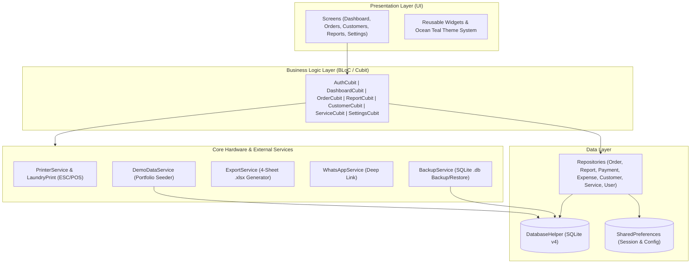
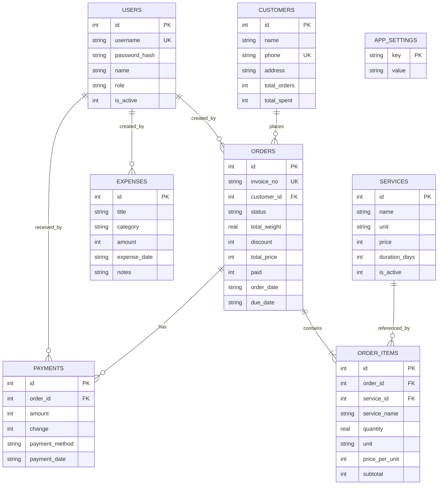

# Bersihin — Offline-First Laundry POS & Cashflow Management

<p align="center">
  
</p>

<p align="center">
  <strong>Aplikasi Kasir (POS) & Manajemen Keuangan Laundry Berbasis Offline-First (Flutter + SQLite + BLoC/Cubit)</strong>
</p>

<p align="center">
  <a href="https://github.com/sukr02k/bersihin/actions/workflows/flutter_ci.yml">
    
  </a>
  
  
  
</p>

---

## Ringkasan Project (Overview)

**Bersihin** adalah aplikasi Point of Sale (POS) dan manajemen operasional laundry yang dirancang dengan pendekatan **100% Offline-First**. Seluruh transaksi, manajemen diskon & piutang, riwayat pelanggan (CRM), pencatatan pengeluaran operasional (*expense tracking*), perhitungan laba bersih, hingga pencetakan struk Bluetooth thermal berjalan langsung di perangkat lokal menggunakan **SQLite** tanpa ketergantungan koneksi internet.

Untuk menjaga keamanan data pada skenario *offline*, aplikasi ini dilengkapi dengan sistem **Backup & Restore Database (`.db`)** bervalidasi header SQLite, ekspor laporan keuangan multi-sheet ke format **Microsoft Excel (`.xlsx`)**, serta fitur **1-Tap Demo Data Seeder** untuk memudahkan pengujian fitur secara instan.

---

## Fitur Utama

### 1. Transaksi & Operasional Kasir
- **Penomoran Invoice Otomatis** (`BRSH-YYMMDD-XXXX`) dengan dukungan kustomisasi prefix.
- **Multi-Layanan & Kalkulasi Berat Akurat**: Mendukung layanan berbasis berat (`kg`) maupun satuan (`pcs`, `pasang`, `meter`) dengan pemisahan kalkulasi total berat khusus item `kg` serta perhitungan otomatis tanggal estimasi selesai (*due date*).
- **Sistem Diskon & Promo Kasir**: Input potongan harga langsung dengan *quick-select chips* (`5%`, `10%`, `15%`) dan tombol pembayaran cepat (`Pas`).
- **Manajemen Pembayaran & Piutang**: Mendukung pembayaran lunas, DP (*deposit*), pelunasan bertahap, serta pencatatan kembalian otomatis.
- **Pelacakan Status & Pembatalan Order (*Void*)**: Alur status fleksibel (`Pending` → `Proses` → `Siap Ambil` → `Selesai`) dilengkapi fitur **Batalkan Order (*Void*)** yang secara otomatis membatalkan pembayaran aktif dan me-*rollback* statistik belanja pelanggan.
- **Overdue Alert Banner**: Peringatan otomatis di *Dashboard* untuk pesanan yang melewati batas waktu estimasi selesai (*due date*).
- **CRM & Riwayat Transaksi Pelanggan**: Auto-save pelanggan baru berdasarkan nomor HP, lencana *Pelanggan Loyal*, serta daftar riwayat transaksi lengkap di halaman detail pelanggan.

### 2. Manajemen Keuangan & Laba Bersih
- **Pencatatan Pengeluaran Operasional (*Expense Tracking*)**: Mencatat biaya operasional (Bahan Baku & Deterjen, Listrik/Air/Gas, Gaji Karyawan, Perawatan Mesin, Sewa Tempat, dll.).
- **Kalkulasi Laba Bersih Otomatis**: Menghitung *Estimasi Laba Bersih* (`Total Omzet Aktif - Total Pengeluaran`) dan *Arus Kas Bersih* (`Total Dibayar - Total Pengeluaran`) dengan mengecualikan transaksi yang dibatalkan (*void*).
- **Visualisasi Grafik**: Grafik pendapatan harian interaktif menggunakan `fl_chart`.
- **Ekspor Laporan ke Excel (`.xlsx`)**: Menghasilkan file Excel 4 *sheet* (`Ringkasan`, `Daftar Order` lengkap dengan kolom Subtotal & Diskon, `Layanan Populer`, dan `Pengeluaran`).

### 3. Integrasi Perangkat & Keamanan Data
- **Cetak Struk Thermal Bluetooth & Preview Struk Digital**: Integrasi protokol ESC/POS untuk kertas 58mm & 80mm dengan fitur *Digital Receipt Preview* (memungkinkan pratinjau struk di layar meskipun tanpa printer fisik) serta kustomisasi *Catatan Kaki Struk (Footer)*.
- **Notifikasi Struk Digital via WhatsApp**: Mengirim rincian nota, diskon, sisa tagihan, dan status cucian langsung ke WhatsApp pelanggan.
- **Backup & Restore Database Lokal (`.db`)**: Mencadangkan file database SQLite ke penyimpanan perangkat atau Google Drive/WhatsApp serta memulihkannya dengan validasi integritas header SQLite.
- **Role-Based Access Control (RBAC)**: Pembagian hak akses antara **Owner** (akses penuh ke Laporan Keuangan, Pengaturan, Manajemen User, dan Backup Data) dan **Kasir** (fokus pada Dashboard dan Transaksi Order).
- **1-Tap Portfolio Demo Data Seeder**: Menu khusus di *Settings* untuk memuat sampel data transaksi 7 hari terakhir, pelanggan loyal, order *overdue*, dan pengeluaran operasional hanya dengan 1 klik.

---

## Arsitektur Aplikasi

Project ini mengimplementasikan **Layered Architecture** dengan pemisahan tanggung jawab (*Separation of Concerns*) menggunakan **Cubit (`flutter_bloc`)** dan **Repository Pattern**:



### Struktur Direktori

```text
lib/
├── core/
│   ├── constants/       # Konfigurasi aplikasi & konstanta global
│   ├── exceptions/      # Custom exception handling
│   ├── services/        # BackupService, DemoDataService, ExportService, PrinterService, LaundryPrint, WhatsAppService
│   ├── theme/           # Design system (Ocean Teal palette, Typography, Spacing)
│   └── utils/           # CurrencyFormatter, DateFormatter, PasswordHelper (Salted SHA-256), InvoiceGenerator
├── data/
│   ├── database/        # DatabaseHelper (SQLite schema v4, indexing & migrations)
│   ├── models/          # Immutable data models (Equatable): Order, OrderItem, Payment, Expense, Customer, Service, User
│   └── repositories/    # Abstraksi query database per domain
├── logic/
│   └── cubits/          # State management berbasis Cubit (Auth, Dashboard, Order, Customer, Service, Report, Printer, Settings, User)
├── presentation/
│   ├── screens/         # Halaman UI per fitur (Dashboard, Orders, Customers, Services, Reports, Settings)
│   └── widgets/         # Komponen UI reusable (OrderCard, StatusBadge, SummaryCard, dll.)
└── main.dart            # Entry point aplikasi
```

---

## Skema Database (ERD)

Database lokal SQLite (`DatabaseHelper`, versi 4) terdiri dari **8 tabel** yang dilengkapi *Foreign Key Constraints* dan *B-Tree Indexes* pada kolom pencarian utama:



---

## Tech Stack

| Kategori | Paket / Teknologi | Kegunaan |
| :--- | :--- | :--- |
| **Framework & Bahasa** | Flutter & Dart (`^3.10.1`) | Cross-platform UI & aplikasi mobile |
| **State Management** | `flutter_bloc` (`^9.1.1`) & `equatable` | Cubit state management & value equality |
| **Local Database** | `sqflite` (`^2.4.2`) | Penyimpanan relasional offline (SQLite v4) |
| **Thermal Printing** | `print_bluetooth_thermal` & `esc_pos_utils_plus` | Cetak struk Bluetooth 58mm / 80mm |
| **Data Visualization** | `fl_chart` (`^1.1.1`) | Grafik analisis pendapatan harian |
| **Spreadsheet Export** | `excel` (`^4.0.6`) & `share_plus` | Ekspor laporan multi-sheet ke `.xlsx` & *file sharing* |
| **Keamanan** | `crypto` (`^3.0.6`) & `uuid` | Salted SHA-256 password hashing |

---

## Cara Menjalankan Project

### 1. Prasyarat
- Flutter SDK `>= 3.10.1`
- Android Studio / VS Code
- Java 17 (untuk build Android)

### 2. Instalasi & Menjalankan Aplikasi
```bash
# Unduh dependencies
flutter pub get

# Jalankan analisis kode & unit test
flutter analyze
flutter test

# Jalankan aplikasi di perangkat / emulator
flutter run
```

### 3. Akun Demo Bawaan & Data Sampel
Saat aplikasi pertama kali dijalankan, database otomatis membuat akun **Owner** bawaan:
- **Username**: `owner`
- **Password**: `admin123`
- Untuk mengisi data transaksi sampel secara instan (7 hari transaksi, pelanggan loyal, *overdue order*, dan pengeluaran operasional), buka menu **Settings → Manajemen Data → Muat Data Demo (Portfolio)**.
